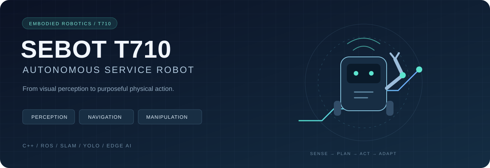

<div align="center">


# SEBOT T710 · Autonomous Service Robot

**An integrated perception, navigation and manipulation stack for robotics competitions and catering scenarios.**

[中文文档](README.md) · [Implementation status](docs/IMPLEMENTATION_STATUS.md) · [Reproduction notes](docs/REPRODUCIBILITY.md)
</div>

## Overview

This repository brings together edge vision, laser mapping, mobile navigation, robotic grasping and task orchestration for the SEBOT T710 platform. A catering state machine connects ordering, object pickup, table delivery and payment through ROS nodes and hardware interfaces.

| Layer | Included implementation |
| :-- | :-- |
| Perception | PaddleDetection/YOLO deployment, PPNC NPU inference, ONNX Runtime post-processing and OpenCV |
| Navigation | GMapping/Hector SLAM, AMCL, EKF, costmaps, GlobalPlanner and DWA |
| Manipulation | Visual feedback, stage-based grasp control, PID correction and Talon serial commands |
| Integration | C++, ROS1/catkin, Qt/RViz, STDR simulation and URDF/MoveIt configuration |

**Engineering version:** this repository contains the T710 ROS1/catkin stack, with ROS Melodic as its historical build environment. Navigation selects Dijkstra and DWA and includes a configurable A* implementation. The broader project extensions are presented below.

## Technical highlights

- **Edge inference pipeline:** model configuration, NPU execution, ONNX post-processing and structured detection results are encapsulated in [`Detection`](sebot_catering/src/sebot_catering/include/detection.hpp).
- **Navigation-to-task interface:** [`Cater`](sebot_catering/src/sebot_catering/src/catering.cpp) sends `move_base` action goals and coordinates task transitions using localization and navigation state.
- **Feedback-driven manipulation:** [`Picking`](sebot_catering/src/sebot_catering/src/picking.cpp) combines target detection, laser distance observations, PID correction and staged arm actions.
- **Modular bring-up:** separate detection, ordering, picking, payment and arm demonstration nodes support targeted hardware debugging.

## Getting started

Use a Linux/ROS1 environment matching the T710 board image. The historical distribution is ROS Melodic. The catering package additionally requires vendor PPNC and ONNX packages, OpenCV, LibSerial and the corresponding hardware. Model binaries are platform-specific.

```bash
git clone https://github.com/wild-pointer-04/sebot-t710-competition.git
cd sebot-t710-competition
export SEBOT_ROOT="$PWD"
source /opt/ros/melodic/setup.bash
cd "$SEBOT_ROOT/sebot_ros_kits"
rosdep install --from-paths src --ignore-src -r -y
catkin_make
source devel/setup.bash
cd "$SEBOT_ROOT/sebot_catering"
rosdep install --from-paths src --ignore-src -r -y
catkin_make
source devel/setup.bash
roslaunch sebot_catering sebot_yolo.launch
```

These commands were derived from the source tree and have not been validated on robot hardware during publication. Vendor SDKs are not supplied by `rosdep`. See the [Chinese README](README.md) for architecture, module links and other launch targets.

## Project results and extensions

**Project stack: C++ · ROS2 · A\* · TEB · SLAM · YOLO · OpenCV · Docker**

- **Model optimization and deployment:** trained YOLO detectors with PaddlePaddle, applied structured pruning and inference acceleration, and containerized algorithms with Docker to improve inference efficiency and cross-platform deployment.
- **Autonomous navigation:** built environment maps with SLAM, developed an improved A* global planner, and combined it with TEB local planning for dynamic trajectory optimization, localization, navigation and obstacle avoidance under ROS2.
- **Learning-based grasping:** designed policy-optimization-based reinforcement learning for arm action selection, trajectory planning and closed-loop control, achieving **96% grasping success in complex scenes**.

## Publication notes

Build products and local recordings are excluded. Runtime model assets are retained. Optional Baidu speech credentials are read from `BAIDU_API_KEY` and `BAIDU_SECRET_KEY`; see [`.env.example`](.env.example).

Original authorship and component licenses are preserved. The repository includes upstream robotics components and does not assign a new blanket license to their contents. See [provenance](docs/PROVENANCE.md).
