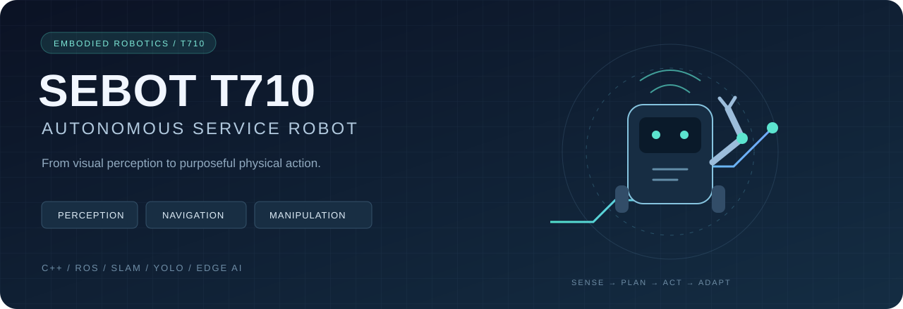
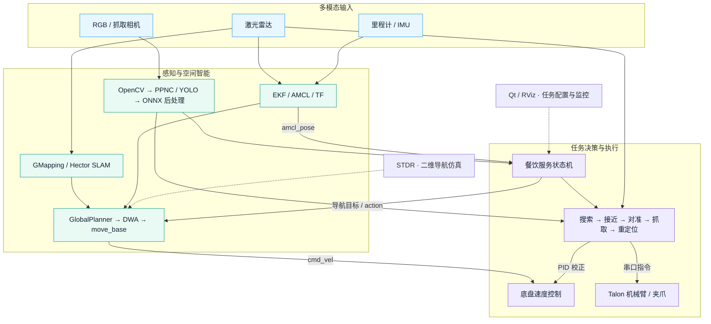

<div align="center">



# SEBOT T710 · 智能服务机器人

**面向机器人竞赛与餐饮服务场景的感知、导航与操作一体化工程**

*Visual Perception · Autonomous Navigation · Closed-loop Manipulation*

<p>


</p>

[系统架构](#系统架构) · [核心技术](#核心技术) · [项目成果与扩展](#项目成果与扩展) · [快速开始](#快速开始) · [English](README.en.md)

</div>

## 项目概览

SEBOT T710 围绕 **“看见目标 → 理解环境 → 到达位置 → 执行抓取 → 完成服务”** 构建机器人任务链路，将端侧视觉推理、激光建图、移动导航、机械臂控制与交互界面整合到同一套竞赛工程中。

系统以 T710 板卡为计算平台，通过 C++ 与 ROS 节点组织底盘、相机、激光雷达和机械臂；上层餐饮任务状态机衔接自主点餐、取餐、送餐与结算，形成从算法模块到场景任务的完整工程结构。

| 技术主线 | 工程实现 | 核心价值 |
| :-- | :-- | :-- |
| **Perception / 视觉感知** | PaddleDetection YOLO、PPNC/NPU 推理、ONNX Runtime 后处理、OpenCV | 将视觉检测结果转化为交互与抓取所需的目标信息 |
| **Navigation / 自主导航** | GMapping / Hector SLAM、AMCL、EKF、全局规划与 DWA | 贯通环境建图、位姿估计、路径规划与速度控制 |
| **Manipulation / 移动操作** | 视觉伺服、抓取状态机、多组 PID、Talon 串口控制 | 协调底盘接近、目标对准、机械爪抓取与放置 |
| **Integration / 系统集成** | ROS action/topic、Qt/RViz、STDR、URDF/MoveIt 配置 | 支持分模块调试、场景编排与仿真联调 |

> **版本说明**：本仓库存档代码采用 **ROS1 / catkin**，历史构建记录指向 ROS Melodic。默认导航配置为 **Dijkstra + DWA**，包含可切换的 A* 实现。ROS2、改进 A*、TEB、训练剪枝、Docker 与强化学习属于维护者提供的项目扩展描述，相关实现尚未收录在此版本；详见[实现范围与成果说明](docs/IMPLEMENTATION_STATUS.md)。

## 系统架构



## 核心技术

### 01 · 面向端侧部署的视觉推理链路

通过 `Detection` 类封装模型加载、图像处理、推理调用和检测结果解析。当前链路使用 **PPNC 执行 T710 NPU 模型推理**，结合 **ONNX Runtime 后处理**与 NMS，以 `type / label / score / bbox` 组织检测结果，供业务模块调用。

- **模型与运行时协同**：保留 `deploy_paddle` 资源、PPNC 配置、`post.onnx` 和标签文件，明确板端推理所需资产。
- **任务相关类别**：当前餐饮标签包括汉堡、芝士、咖啡、可乐、圣代、蛋糕及订单标识。
- **独立调试入口**：`sebot_yolo` 提供检测框可视化与帧耗时输出，便于在目标硬件上观察推理表现。

代码入口：[推理封装](sebot_catering/src/sebot_catering/include/detection.hpp) · [YOLO 演示节点](sebot_catering/src/sebot_catering/unit/yolo.cpp) · [模型资源](sebot_catering/src/sebot_catering/res/model)

### 02 · 从激光建图到移动底盘的导航闭环

导航链路由 **SLAM 建图 → AMCL 定位 → 代价地图 → 全局路径规划 → 局部速度规划**组成；结合轮式里程计、IMU 与 `robot_pose_ekf`，向上层任务提供定位与导航能力。

- **建图与定位分离**：提供 GMapping、Hector 两条建图路径，地图保存后由 `map_server` 与 AMCL 支撑导航。
- **可配置全局规划**：`GlobalPlanner` 集成 Dijkstra / A*；当前 `use_dijkstra: true`，可在适配地图与机器人参数后切换 A*。
- **局部避障与恢复**：当前使用 DWA，配置包含障碍层清理、旋转恢复、规划重试与超时参数。
- **任务级导航接口**：通过 `move_base` action 发送目标，由餐饮状态机管理到达、超时及后续动作。

代码入口：[导航启动](sebot_ros_kits/src/sebot_navigation/sebot_navigation/launch/sebot_navigation.launch) · [A* 实现](sebot_ros_kits/src/sebot_navigation/global_planner/src/astar.cpp) · [规划配置](sebot_ros_kits/src/sebot_navigation/sebot_navigation/param)

### 03 · 视觉伺服与机械臂协同抓取

抓取模块将任务拆分为 **姿态校正、目标搜索、底盘接近、夹爪对准、抓取执行与重定位**。视觉检测提供图像偏差，激光雷达提供接近距离信息，PID 控制器分别调节方向、距离、位置和夹爪对准。

```text
START → POSE → SEARCH → FORWARD → AIM → GRAB → LOCAL → END
          姿态     搜索      接近       对准     抓取     重定位
```

`Talon` 封装机械臂串口协议、关节使能与动作调用；底盘和机械臂在任务阶段内协同完成取放。当前公开实现可直接观察到的是 **状态机 + PID + 预定义动作控制**。

代码入口：[抓取控制](sebot_catering/src/sebot_catering/src/picking.cpp) · [机械臂接口](sebot_catering/src/sebot_catering/include/arm.hpp) · [抓取参数](sebot_catering/src/sebot_catering/launch/sebot_picking.launch)

### 04 · 从功能节点到完整服务流程

`Cater` 以场景状态机组织服务流程，通过 `Ordering`、`Picking`、`Paying` 模块衔接点餐、取放与结算；导航点位从场景配置中读取。配套 Qt/RViz 界面、STDR 仿真工作区与独立功能演示，支持从单模块验证推进到整机联调。

代码入口：[任务编排](sebot_catering/src/sebot_catering/src/catering.cpp) · [场景点位](sebot_catering/src/sebot_catering/res/location.xml) · [定位界面](sebot_location/src/sebot_location)

## 项目成果与扩展

以下为维护者提供的项目经历与扩展成果，覆盖比当前代码快照更广的研发范围。

| 方向 | 项目经历与成果 | 当前仓库对应内容 |
| :-- | :-- | :-- |
| **模型优化与部署** | 基于 PaddlePaddle 完成 YOLO 训练、结构化剪枝与推理加速，结合 Docker 实现算法容器化部署 | 已收录板端推理代码和模型资源；训练、剪枝与 Docker 文件未收录 |
| **导航算法与系统** | 基于 SLAM 构建环境地图，设计改进 A*，结合 TEB 进行动态轨迹优化，并在 ROS2 下完成定位、导航与避障控制 | 已收录 ROS1 SLAM、A*/Dijkstra 和 DWA 基础工程；ROS2、TEB 与改进算法版本未收录 |
| **学习型抓取策略** | 基于策略优化的强化学习设计抓取动作策略，完成动作决策、轨迹规划和闭环控制；复杂场景抓取成功率 **96%** | 已收录状态机与 PID 抓取控制；策略训练、权重及评测记录未收录 |

**96% 为维护者提供的项目结果**。仓库尚未附测试次数、场景划分、成功判定标准和原始日志，因此不作为本代码版本的可复现基准。更多信息见[成果与证据对应表](docs/IMPLEMENTATION_STATUS.md)。

## 仓库结构

```text
sebot-t710-competition/
├── sebot_catering/       # 餐饮任务：检测、点餐、取放、送餐与结算
├── sebot_ros_kits/       # 基础能力工作区
│   └── src/
│       ├── sebot_driver/      # 雷达、机械臂、URDF、MoveIt、EKF
│       ├── sebot_robot/       # 底盘通信、传感器话题与坐标变换
│       ├── sebot_navigation/  # AMCL、costmap、全局与局部规划
│       ├── sebot_slam/        # GMapping / Hector
│       ├── sebot_visions/     # 视觉应用与模型资源
│       ├── sebot_speech/      # 语音识别、合成与播放
│       ├── sebot_follow/      # 跟随功能
│       └── sebot_simulator/   # 仿真资源
├── sebot_ros_stdr/       # STDR 二维仿真与导航演示
├── sebot_location/       # Qt / RViz 场景定位工具
├── sebot_startup/        # 启动界面与辅助脚本
└── docs/                # 实现范围、复现说明与展示资源
```

## 快速开始

### 环境前提

本工程面向 **Linux + ROS1**，历史构建环境为 **ROS Melodic**。完整餐饮功能还依赖 T710 板卡对应的 **PPNC SDK、ONNX Runtime、OpenCV、LibSerial** 以及相机、雷达和机械臂驱动。Qt 界面需要 Qt5 与 RViz。板端二进制模型不保证可在普通 PC 上运行。

以下命令依据目录、CMake 和 launch 文件整理，**尚未在本次发布环境中完成整机编译或硬件验证**。

```bash
git clone https://github.com/wild-pointer-04/sebot-t710-competition.git
cd sebot-t710-competition
export SEBOT_ROOT="$PWD"
source /opt/ros/melodic/setup.bash

# 先编译基础工作区，使用与板卡镜像匹配的依赖和 SDK。
cd "$SEBOT_ROOT/sebot_ros_kits"
rosdep install --from-paths src --ignore-src -r -y
catkin_make
source devel/setup.bash

# 餐饮应用叠加在基础工作区上。
cd "$SEBOT_ROOT/sebot_catering"
rosdep install --from-paths src --ignore-src -r -y
catkin_make
source devel/setup.bash
```

`rosdep` 处理 ROS 依赖；`ppnc`、`onnx` 等厂商 SDK 仍需在目标板卡环境中正确配置。新终端运行前，按相同顺序加载 ROS、基础工作区与应用工作区的 `setup.bash`。

| 场景 | 启动入口 |
| :-- | :-- |
| YOLO 检测调试 | `roslaunch sebot_catering sebot_yolo.launch` |
| 机械臂抓取调试 | `roslaunch sebot_catering sebot_picking.launch` |
| 完整餐饮任务 | `roslaunch sebot_catering sebot_catering.launch` |
| GMapping 建图 | `roslaunch sebot_slam sebot_gmapping.launch` |
| Hector 建图 | `roslaunch sebot_slam sebot_hector.launch` |
| 移动导航 | `roslaunch sebot_navigation sebot_navigation.launch` |

每次选择一个适用场景启动，避免多个 launch 重复启动底盘、雷达或导航节点。首次连接硬件前，核对设备别名、串口、地图、场景点位及机械臂动作空间。STDR 仿真与完整依赖说明见[复现指南](docs/REPRODUCIBILITY.md)。

## 工程说明

- **发布内容**：保留源码、配置、地图、模型与运行资源；排除历史 `build/`、`devel/`、Qt 构建目录、编辑器缓存和本地录音。
- **语音配置**：云端语音凭据由 `BAIDU_API_KEY`、`BAIDU_SECRET_KEY` 环境变量读取，示例见 [`.env.example`](.env.example)。
- **验证边界**：`unit/` 中的程序主要是连接实际设备的功能演示；本次发布完成源码与文档静态检查，未将其标记为已通过的自动化或整机测试。
- **来源与许可**：工程包含 SEBOT 平台代码及 ROS navigation、Hector SLAM、GMapping、STDR 等组件，保留原始作者、版权和各组件许可。当前未为整个工程额外指定统一许可证，详见[来源说明](docs/PROVENANCE.md)。

---

<div align="center">
<b>Perception → Planning → Control → Service</b><br/>
<sub>面向真实场景的机器人系统工程 · SEBOT T710</sub>
</div>
